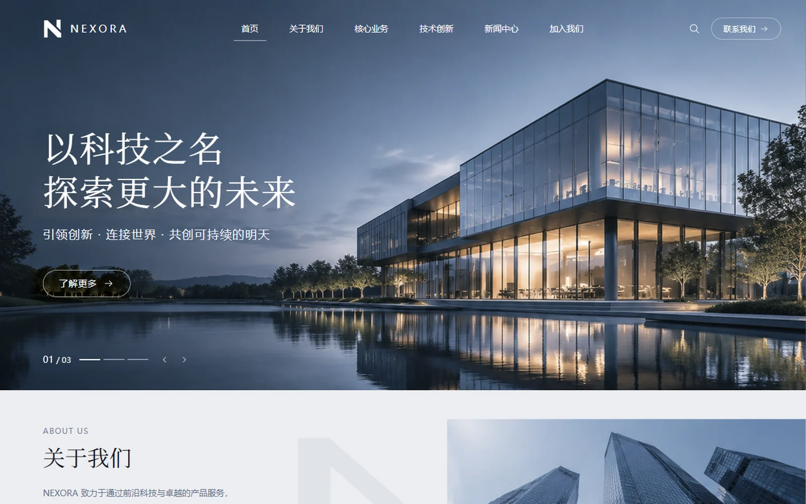

# NewPress Theme

独立的 NewPress 主题源码与发行仓库。主题不随 NewPress 主程序源码包发布，通过主题市场或本地 ZIP 安装。

目前包含 **Nexora 1.0.1**：科技企业官网主题，使用 `public/v1` 展示契约，带科技园建筑首屏、企业介绍、业务、新闻、人才与联系区域。源代码及素材许可见 [主题说明](sources/nexora/README.md)。



## 目录

- `sources/nexora/`：可独立安装的主题源码，含清单、模板、设置、图片和字体。
- `packages/themes/`：版本化 ZIP，已发布的同版本文件不可覆盖。
- `previews/themes/`：随签名目录发布的独立封面；由发布工具生成。
- `releases/`：发行说明与元数据。
- `tests/`：主题前端及真实核心集成检查；不进入安装包。
- `scripts/`：资源构建、ZIP 打包和核心集成测试助手。

## 开发与安装

```powershell
npm ci
npm run build
npm run check
npm test
python scripts/check_core.py --core "../newpress"
```

发布包已包含浏览器资源，运行时不需要 Node 或 Python。使用接入官方主题源的 NewPress，在后台「主题市场」刷新目录、安装 Nexora，然后点击「使用此主题」。已有独立主题源支持的版本也可按 [部署配置](deployment.env.example) 指定目录与公钥。

离线安装：在 NewPress 部署目录执行 `newpress theme install <Nexora ZIP 绝对路径>`（安装时停止占用主题目录的实例），启动后到后台使用此主题。仓库已经包含 Nexora 1.0.1 安装包；发布新版本时先递增版本并指定新的 ZIP 文件名，打包器拒绝覆盖旧制品。

主题只实现公共展示；登录、后台、内容、媒体、评论、支付及权限仍由核心处理。主题设置保存在站点数据目录；切换和卸载不会删除文章或自定义设置。

## 仓库与发行目录

- GitHub 主仓库：[Orangefen/NewPress_Theme](https://github.com/Orangefen/NewPress_Theme)
- Gitee 镜像：[chunyangnet_0/NewPress_Theme](https://gitee.com/chunyangnet_0/NewPress_Theme)

两端使用相同的 `main` 提交，同时托管源码、签名目录、封面和安装包，与主程序和 `newpress_Plug` 分别发布。

核心的市场界面、安装校验和切换逻辑保留在 NewPress。此仓库只提供主题及已签名的目录，不包含服务器逻辑、站点数据或私钥。配套核心默认使用独立的主题目录和公钥；自定义源必须同时指定地址与公钥，插件源配置不会更改主题来源。

首个目录为 `catalog.themes-v1.json`（schema 2、序号 1），包含 Nexora 1.0.1，有效期至 **2027-11-16 00:00 UTC**。可读元数据见 `catalog.themes-v1.readable.json`，公钥副本见 `signing-public-key.txt`。更新目录需要递增序号并重新签名，不能依赖仓库中的公钥文件自动建立或更改信任。[发布说明](PUBLISHING.md) 包含后续发布与镜像同步流程。
